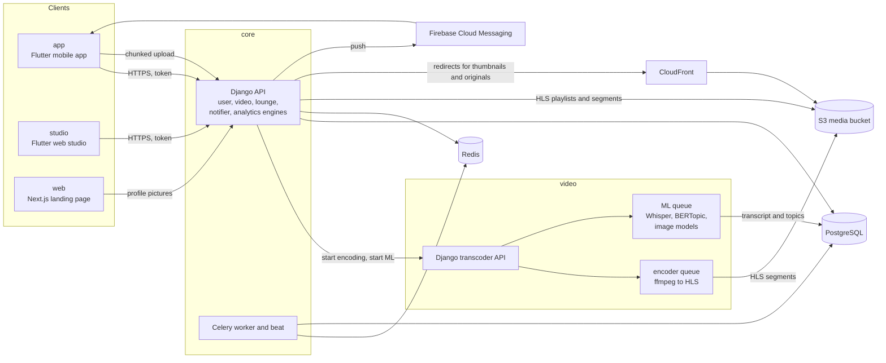

# LimeLight Social

LimeLight Social was a video platform for creators in India. People watched and uploaded videos, posted threads,
and joined lounges, which were community spaces run by a creator. Creators earned experience points and levels from how their work was received,
and the app ranked videos and creators by city, region and country.

Affan Ahmed ([@hyprcat](https://github.com/hyprcat)) founded it in 2023 and built it until it was wound down in October 2024.
The company was called Hazel. This repository is the source of the whole product, published as a record of that work.

## What is here

| Directory | What it is | Stack |
| --- | --- | --- |
| [`core/`](core) | The main API: accounts, videos, comments, feeds, lounges, notifications, analytics. | Python, Django, PostgreSQL, Redis, Celery |
| [`video/`](video) | The video service: transcodes uploads to HLS and runs the models that describe and tag each video. | Python, Django, Celery, ffmpeg, Whisper, BERTopic |
| [`app/`](app) | The Android and iOS app. | Flutter, Dart, flutter_bloc |
| [`studio/`](studio) | The first creator studio for uploading and managing videos in a browser. Retired once uploading moved into the app. | Flutter web, Dart |
| [`web/`](web) | The public landing page. | Next.js, React, Tailwind CSS |

Each directory has its own README with the features, the folder that implements each one, and how to configure it.

## How the parts fit together

A video's path: the app uploads the file to `core` in chunks, `core` saves a draft and asks `video` to process it,
the encoder queue writes one HLS rendition per resolution to S3, the ML queue transcribes the audio and tags the video with topics,
and the app then plays `video_engine/stream/<id>/<resolution>/video.m3u8` through `core`.

## Numbers

According to the author, LimeLight had 1,200 users, streamed 2 TB of video, and took over 100,000 lines of code to build.
The repository cannot prove the first two. On the third: the published tree holds about 58,500 lines of hand-written code,
counted with `cloc` and leaving out generated files, migrations and copied third-party components
(about 44,000 Dart in `app`, 3,700 in `studio`, 1,100 TypeScript in `web`, 8,000 Python in `core`, 1,800 in `video`).
The larger figure counts everything written and rewritten along the way, which the private commit histories record but a single published commit does not.

## Written by hand

Every line here predates AI coding tools for the author. He wrote all of it by hand: the mobile app, the backend,
the feeds and recommendations, and the small models in the video service.
It was built quickly by one person and it reads that way in places. Please read it kindly.

Before publishing, the code was tidied without changing what it does: files and folders were renamed, dead code and
commented-out blocks were removed, and secrets, licensed fonts and stock media were taken out. Nothing was rewritten.

## Status

The code dates from 2023 and 2024 and the last release shipped in October 2024. The servers are offline.
Nothing here is maintained, and it may not build or run against current toolchains without work.
Service credentials are not included. Each README says what to supply.

## Licence

[MIT](LICENSE). Free to use, change, self-host and build on, including commercially.

Third-party logos, fonts and components keep their own licences. See the README in each directory.
